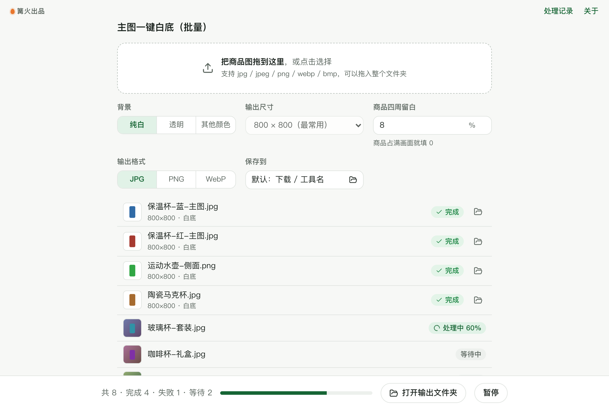

# 主图一键白底（批量）

> 篝火出品 · 收录于篝火 App 应用区

本地抠图，整个文件夹一次处理



## 下载

到 [Releases](https://github.com/campfire-code/bg-remover-batch/releases/latest) 下载对应安装包：

| 电脑 | 文件 |
|---|---|
| Windows 10 / 11 | `bg-remover-batch_版本号_windows-x64-setup.exe` |
| Mac（Apple 芯片） | `bg-remover-batch_版本号_mac-arm64.dmg` |
| Mac（Intel 芯片） | `bg-remover-batch_版本号_mac-x64.dmg` |

系统要求：Windows 10 / 11；macOS 13.3 或更新（抠图引擎需要较新的系统网页引擎）。

第一次打开：
- **Windows**：如果弹出「Windows 已保护你的电脑」，点「更多信息」→「仍要运行」。
- **Mac**：如果提示「无法验证开发者」，打开「系统设置 → 隐私与安全性」，在下方点「仍要打开」。

## 怎么用

1. 把商品图或整个文件夹拖进窗口，支持 JPG、PNG、WebP、BMP。
2. 选择背景：纯白、透明，或其他颜色（填颜色代码，例如 `#F5F5F5`）。
3. 选择输出尺寸，默认 800×800。商品会自动居中，四周按「留白」比例空出边距；选「保持原图尺寸」则只换背景、不重新排版。
4. 点「开始处理」。白底图保存为「原文件名-白底.jpg」，透明背景保存为「原文件名-抠图.png」。默认保存在「下载 / 主图一键白底（批量）」。

**说明**
- 抠图模型内置在软件里，不联网、不上传，第一次处理会多花 1～2 秒加载模型。
- 目前用的是小模型（U²-Net 的 u2netp），对背景干净、主体清楚的商品图效果最好。杯子把手、细绳、毛发这类细长部分可能抠不全，处理后请检查。以后会加可选的高精度模型。
- 抠图结果建议人工抽查后再上传到店铺。

## 验收用例

把 `samples/` 文件夹拖进窗口，保持默认参数（纯白、800×800、留白 8%、JPG），点「开始处理」：

| 示例文件 | 应得到 |
|---|---|
| `保温杯-桌面背景.png` | `保温杯-桌面背景-白底.jpg`，800×800，木纹背景被去掉，蓝色杯子居中、白底 |
| `损坏文件.jpg` | 列表显示「失败：无法识别这张图片，可能已损坏或格式不受支持」 |

背景改成「透明」再处理一次，应得到 `保温杯-桌面背景-抠图.png`，尺寸 800×800，背景透明。

## 自己编译

需要 Node.js 22、pnpm、Rust。

```bash
pnpm install
pnpm test          # 单元测试
pnpm tauri dev     # 开发运行
pnpm tauri build   # 打包
```

界面框架在 `src/kit`（所有 campfire-code 工具共用），本工具的逻辑在 `src/tool`。

## 致谢

本工具参考了开源项目 [danielgatis/rembg](https://github.com/danielgatis/rembg)（MIT）的处理方式，使用其发布的 U²-Net 小模型（Apache-2.0），推理用 [ONNX Runtime](https://github.com/microsoft/onnxruntime)（MIT）。

## 归属

本工具由**篝火**出品，是篝火 App 应用区收录的开源工具之一，由篝火（GitHub 组织 [campfire-code](https://github.com/campfire-code)）维护与更新。全部工具的目录见 [toolkit-hub](https://github.com/campfire-code/toolkit-hub)。

## 许可证

MIT，版权方为篝火（campfire-code）。
